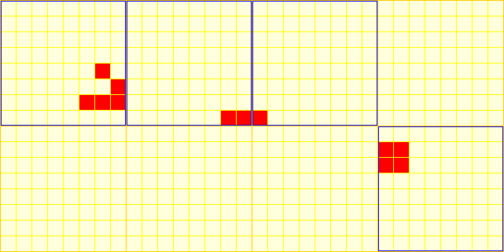

# The Game of Life

2026 CAU Design Patterns Term Project (Team 12). This Java Swing application is based on Allen I. Holub's implementation of Conway's Game of Life.



## How to Run

1. Install JDK 21 and run `java -version` to verify your installation.
2. Clone the repository and enter the project directory.

   ```sh
   git clone https://github.com/2026-DP-TermProject-12/the-game-of-life.git
   cd the-game-of-life
   ```

3. Run the command for your operating system to open the game window.

   | Operating system | Command |
   | --- | --- |
   | macOS or Linux | `./gradlew run` |
   | Windows (PowerShell) | `.\gradlew.bat run` |


## Team and Responsibilities

| Member | Responsibilities |
| --- | --- |
| [김민주](https://github.com/orgs/2026-DP-TermProject-12/people/mminjukim) | Provide preset patterns using the Prototype pattern. |
| [김태우](https://github.com/orgs/2026-DP-TermProject-12/people/rlaxodn0320) | Add a boundary mode. |
| [박민규](https://github.com/orgs/2026-DP-TermProject-12/people/Shorangnavi2) | Apply the State pattern to `Resident`'s next-state logic and use the Visitor pattern to calculate scores by survival pattern. |
| [손태호](https://github.com/orgs/2026-DP-TermProject-12/people/meilleur777) | Separate menu creation from `Clock` and track live cells in a `HashSet`. |
| [왕쌍치](https://github.com/orgs/2026-DP-TermProject-12/people/xianyu12371) | Improve state handling and rendering in `Resident`. |
| [장예서](https://github.com/orgs/2026-DP-TermProject-12/people/nattierblue) | Add undo and redo. |

## Original README.txt

```
HolubLife.jar
Version 1.02
Released 16 Jul., 2005


version		description

1.01		Alexey Marinichev: Fixed the "stuck glider" problem in
Neighborhood.java.

1.02		Added a workaround to a Swing bug that caused menus
to be overwritten by the game. Swing just draws menus
directly on the content-pane's main canvas, so these
menus were being overwritten by the game itself if you
selected a menu while the game was runing. Modified
the Clock class to suspend any board updating when
menu items are displayed.
```