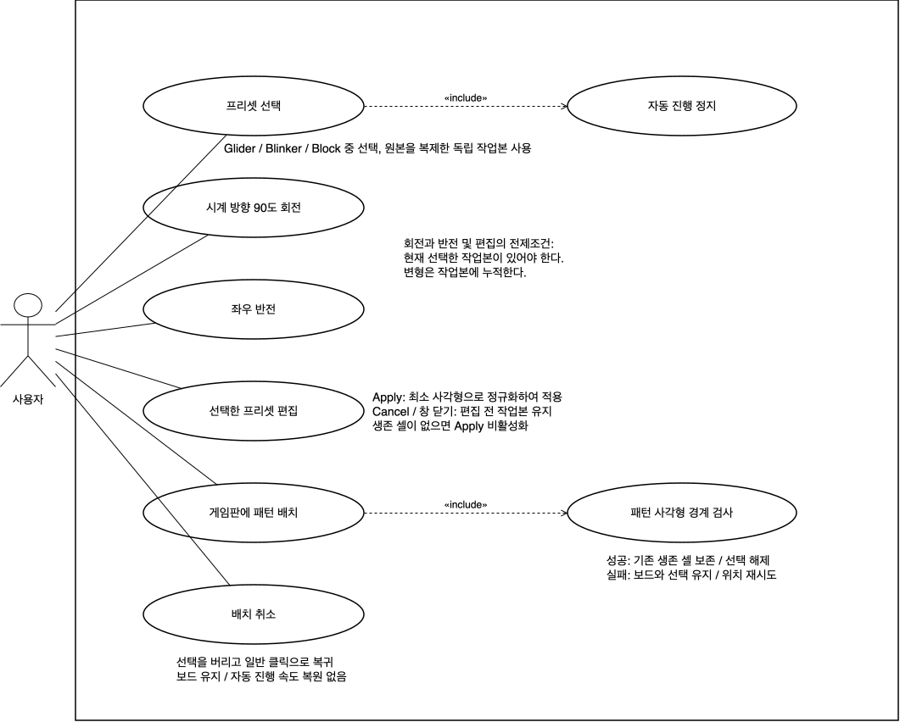
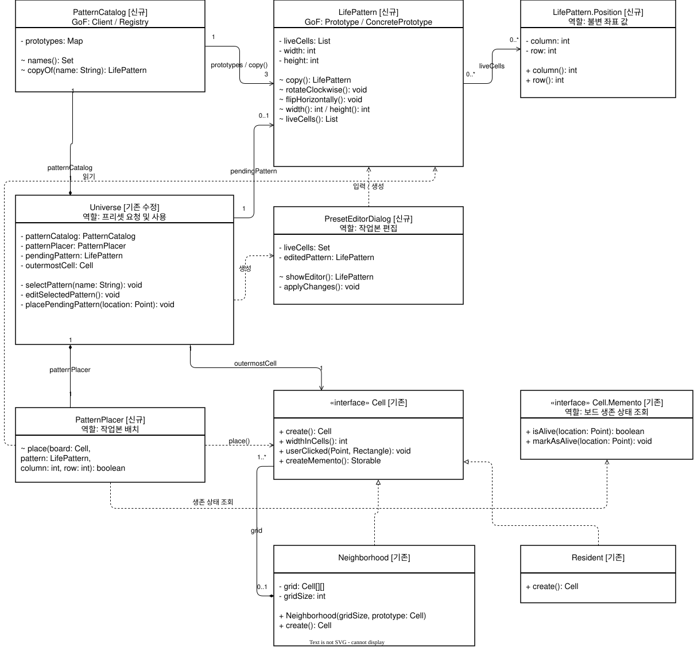
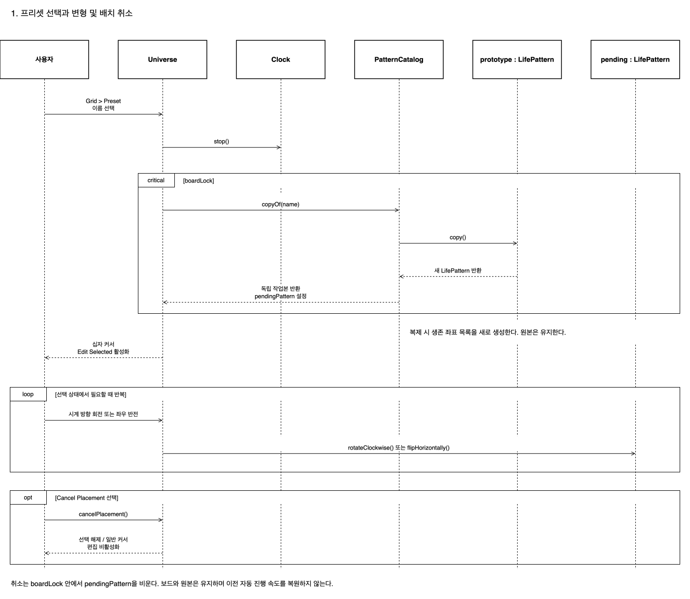

# 프리셋 패턴 선택 및 배치

## 1. 추가한 기능과 사용 방법

### 1.1. 기본 프리셋

`Grid > Preset`에서 다음 패턴을 선택할 수 있다. 좌표는 패턴 왼쪽 위를 `(0, 0)`으로 하며 열은 오른쪽으로 행은 아래쪽으로 증가한다.

| 프리셋 | 초기 크기 | 생존 셀의 상대 좌표 | 실험 목적 |
| --- | --- | --- | --- |
| Glider | 3 × 3 | `(1, 0)`, `(2, 1)`, `(0, 2)`, `(1, 2)`, `(2, 2)` | 세대가 진행되며 이동하는 패턴과 방향 변화 관찰 |
| Blinker | 3 × 1 | `(0, 0)`, `(1, 0)`, `(2, 0)` | 가로와 세로를 반복하는 주기 2 진동 관찰 |
| Block | 2 × 2 | `(0, 0)`, `(1, 0)`, `(0, 1)`, `(1, 1)` | 형태를 유지하는 정물 관찰 |

### 1.2. 선택부터 배치까지

1. `Grid > Preset`에서 패턴을 선택한다. 자동 진행이 정지하고 원본의 복제본이 선택된다. 커서는 십자 모양으로 바뀐다.
2. 필요하면 `Rotate Clockwise`로 시계 방향 90도 회전을 적용하거나 `Flip Horizontally`로 좌우를 반전한다. 변환은 현재 작업본에 누적된다.
3. `Edit Selected`를 열어 셀을 추가하거나 삭제할 수 있다. `Apply`는 편집 결과를 선택하고 `Cancel` 또는 창 닫기는 편집 직전 작업본을 유지한다.
4. 게임판을 클릭하면 클릭한 셀을 패턴 사각형의 왼쪽 위 원점으로 사용해 배치를 시도한다.
5. 성공하면 선택이 해제되고 일반 클릭 모드로 돌아간다. 자동 진행은 정지 상태이며 사용자가 다음 세대를 진행할 수 있다.
6. 경계를 벗어나면 안내 메시지를 표시하고 선택 상태를 유지한다. 다른 위치에서 다시 시도할 수 있다.

`Cancel Placement`는 선택을 버리고 일반 클릭 모드로 돌아간다. 기존 게임판은 그대로 유지하며 이전 자동 진행 속도를 복원하지 않는다. 같은 프리셋을 다시 선택하면 편집 전 원본에서 새 작업본을 만든다.

### 1.3. 배치와 편집의 동작 규칙

| 상황 | 동작 |
| --- | --- |
| 패턴의 생존 셀과 기존 생존 셀이 겹침 | 기존 생존 상태 유지 |
| 패턴의 빈 칸에 기존 생존 셀이 있음 | 기존 생존 상태 유지 |
| 패턴 사각형 밖에 기존 생존 셀이 있음 | 기존 생존 상태 유지 |
| 패턴 사각형 일부가 게임판 밖으로 나감 | 전체 배치를 거부하고 보드 유지 |
| 같은 패턴을 같은 위치에 재배치 | 성공하며 생존 상태 유지 |
| 프리셋을 선택하지 않음 | 일반 클릭으로 셀 상태 전환. `Edit Selected`는 비활성화 |
| 선택 없이 회전 또는 반전 메뉴 실행 | 변경 없음 |
| 편집기에서 생존 셀을 모두 삭제 | `Apply` 비활성화 |
| 편집기에서 적용 | 생존 셀을 둘러싼 최소 사각형으로 크기를 정하고 좌표를 `(0, 0)` 기준으로 정규화 |

배치는 기존 상태를 덮어쓰는 붙여넣기가 아니라 **생존 셀을 추가하는 합집합 연산**이다. 프리셋의 빈 칸은 기존 셀을 죽이지 않는다.

### 1.4. 유스케이스 다이어그램



[유스케이스 다이어그램 원본 SVG](diagrams/usecase_diagram.svg)

## 2. 기능을 추가한 이유

기존에는 초기 상태를 구성하려면 셀을 하나씩 클릭하거나 저장된 파일을 불러와야 했다. 같은 Glider를 여러 위치에 놓거나 방향만 바꿔 비교하려면 좌표를 다시 계산하며 입력해야 했다. 이 방식은 실험 준비에 시간이 걸리고 클릭 실수로 의도한 패턴과 다른 상태가 만들어질 수 있다.

프리셋은 자주 쓰는 초기 상태를 재사용해 입력 부담을 줄인다. 회전과 반전은 방향별 실험을 지원하고 프리셋 편집은 기본 패턴 일부를 바꾼 결과를 비교할 수 있게 한다. 기존 파일 불러오기와 달리 현재 보드를 유지한 채 원하는 위치에 패턴을 추가할 수 있다는 점도 필요했다.

이 목적에서 다음 설계 조건을 도출했다.

- 선택과 변형 때문에 카탈로그의 원본이 바뀌지 않아야 한다.
- 편집을 취소하면 선택한 작업본과 게임판이 바뀌지 않아야 한다.
- 배치 실패로 게임판 일부만 변경되어서는 안 된다.
- 겹쳐 배치해도 기존 생존 셀이 꺼지지 않아야 한다.
- 기존 `Cell` 계층의 변경 추적과 세대 계산을 그대로 이용해야 한다.
- 세대 계산이 패턴 배치 도중의 상태를 읽지 않도록 조정해야 한다.

## 3. 설계 후보와 선택 과정

### 3.1. 후보 비교

| 후보 | 방식 | 장점 | 부담과 최종 판단 |
| --- | --- | --- | --- |
| A. Prototype | 카탈로그가 원본을 보관하고 선택할 때 `copy()`로 작업본 생성 | 원본 보존과 독립 변형을 같은 복제 계약으로 설명 가능. 패턴별 하위 클래스 불필요 | 가변 데이터 공유를 막는 복사 설계 필요. 편집을 포함한 현재 요구에 적합해 채택 |
| B. Builder | `size()`, `aliveAt()`, `build()` 등으로 단계별 생성 | 복잡한 생성 절차와 입력 검증을 표현하기 좋음 | 원본 재사용과 선택본의 독립성은 별도 해결 필요. 현재 패턴 생성은 생성자와 좌표 목록으로 충분해 도입하지 않음 |
| C. 불변 프리셋과 배치 시 좌표 변환 | 원본을 공유하고 배치 직전에 각도 및 반전 상태로 좌표 계산 | 원본 변경 위험이 작고 선택마다 좌표 목록을 복제할 필요 없음 | 자유 편집을 포함하면 편집 결과와 원본 및 변환 상태를 연결하는 추가 모델 필요. 현재는 단일 작업본에 변환 결과를 반영하는 쪽을 선택 |

Builder와 Prototype은 배타적인 패턴이 아니다. 향후 생성 규칙이 복잡해지면 Builder로 원본을 만든 뒤 Prototype으로 복제할 수도 있다.

### 3.2. 최종적으로 Prototype을 선택한 이유

Glider, Blinker, Block은 같은 자료구조를 사용하고 좌표 데이터만 다르다. 종류마다 클래스를 만들기보다 등록된 객체를 복제하면 생성과 선택 흐름을 통일할 수 있다.

선택한 작업본이 현재 방향과 크기를 직접 보관하므로 편집기와 배치기는 회전 각도나 반전 플래그를 해석할 필요가 없다. 둘 다 현재 `LifePattern`의 좌표를 사용한다. 특히 회전 후 편집하거나 편집 후 반전하는 흐름에서도 별도 변환 상태와 편집 상태를 동기화할 필요가 없다.

이를 위해 선택 때마다 생존 좌표 목록을 복사하는 비용과 가변 객체의 소유권 관리 부담을 받아들였다. 현재 기본 패턴은 생존 셀이 적고 UI에서 선택할 때 복제하므로 이 구조가 요구사항에 단순하고 알맞다고 판단했다. 성능 우위는 별도로 측정하지 않았다.

## 4. 클래스 구조와 책임

### 4.1. 클래스 다이어그램



[클래스 다이어그램 원본 SVG](diagrams/class_diagram.svg)

| 클래스 | 책임 | 주요 협력 |
| --- | --- | --- |
| `LifePattern` | 패턴 크기와 생존 좌표 보관. 독립 복제와 현재 좌표의 회전 및 반전 | 카탈로그가 원본으로 보관하고 UI 및 배치기가 작업본 사용 |
| `LifePattern.Position` | 열과 행을 담는 불변 `record` 값 | 목록 요소를 안전하게 공유하고 변환 시 새 좌표로 대체 |
| `PatternCatalog` | 기본 원본 등록과 이름 조회 및 복제 요청 | `copyOf(name)`에서 등록된 `LifePattern.copy()` 호출 |
| `PresetEditorDialog` | 편집 초안을 별도 격자에 보관하고 적용 시 새 패턴 생성 | `Universe`에서 입력받은 작업본을 읽고 결과 반환 |
| `PatternPlacer` | 사각형 경계 검사와 좌표 이동 및 기존 셀을 보존하는 배치 | `Cell.Memento` 조회 후 `Cell.userClicked()` 호출 |
| `Universe` | 메뉴와 선택 상태 및 클릭 흐름 연결. 세대 진행과 배치 조정 | 카탈로그와 편집기 및 배치기를 연결 |
| 기존 `Cell`, `Neighborhood`, `Resident` | 게임판의 Composite 구조와 클릭 및 세대 계산 제공 | 프리셋 전용 인터페이스를 추가하지 않고 기존 계약 재사용 |

`LifePattern`이 Prototype의 복제 계약과 구체 구현을 함께 담당한다. 복제 가능한 타입이 하나이므로 별도 `Prototype` 인터페이스나 `GliderPattern` 등의 하위 클래스는 추가하지 않았다. `PatternCatalog`는 원본을 등록하는 Registry이면서 실제 `copy()`를 호출하는 Client다. `Universe`는 카탈로그에 복제본을 요청하고 그 결과를 사용하는 상위 클라이언트다.

기존 `Neighborhood`도 `Cell.create()`를 이용해 하위 셀을 생성하지만 새 `LifePattern.copy()`는 현재 패턴의 크기와 생존 좌표를 보존한 복제이다.

### 4.2. 소유권과 복제 경계

```text
PatternCatalog.prototypes
    원본 LifePattern
        |
        | copyOf(name) -> prototype.copy()
        v
Universe.pendingPattern
    선택된 독립 작업본
        |
        +-> rotateClockwise() / flipHorizontally()
        |
        +-> PresetEditorDialog의 별도 Set<Position>
        |       Apply: 새 LifePattern 반환 후 작업본 교체
        |       Cancel: 결과 null, 기존 작업본 유지
        |
        +-> PatternPlacer.place(): 현재 좌표를 읽어 보드에 반영
```

`LifePattern` 생성자는 입력 목록을 `new ArrayList<>(liveCells)`로 복사한다. `copy()`도 생성자를 호출하므로 원본과 복제본은 서로 다른 가변 목록을 소유한다. 폭과 높이는 기본형 값으로 복사된다.

목록의 각 `Position`은 정수 두 개를 가진 불변 값이다. 따라서 좌표 객체 자체를 재귀적으로 복제할 필요는 없다. 가변 컨테이너는 분리하고 불변 요소는 공유해도 변형의 독립성이 유지된다. 회전과 반전에서는 기존 `Position`을 수정하지 않고 새 값으로 목록 요소를 교체한다.

`liveCells()`는 수정할 수 없는 목록 뷰를 반환한다. 외부에서 셀을 추가하거나 삭제할 수 없지만 해당 패턴을 나중에 회전하면 이미 얻은 뷰에도 변경된 좌표가 보인다. 불변 스냅샷을 반환하는 API와는 차이가 있다. 카탈로그의 원본은 외부에 직접 반환하지 않으며 `names()` 역시 수정할 수 없는 뷰다.

### 4.3. 패턴 표현과 좌표 변환

패턴은 `width`, `height`, 생존 셀 목록으로 표현한다. 죽은 셀은 목록에 저장하지 않는다. 크기는 생존 셀만으로 매번 계산하지 않고 빈 행과 열까지 포함해 유지한다. 그래야 비대칭 패턴의 변환과 배치 경계를 일관되게 판단할 수 있다.

원래 크기가 `W × H`이고 좌표가 `(x, y)`일 때 변환은 다음과 같다.

| 연산 | 변환된 좌표 | 변환 후 크기 |
| --- | --- | --- |
| 시계 방향 90도 회전 | `(H - 1 - y, x)` | `H × W` |
| 좌우 반전 | `(W - 1 - x, y)` | `W × H` |
| 원점 `(c, r)`에 배치 | `(c + x, r + y)` | 패턴 크기는 유지 |

회전은 모든 좌표를 **변환 전 높이**로 계산한 뒤 폭과 높이를 바꾼다. 반전은 현재 폭을 사용하므로 회전 직후 반전하면 회전된 폭이 기준이다. 예를 들어 가로 Blinker는 회전 후 크기가 `1 × 3`이 되고 생존 좌표는 `(0, 0)`, `(0, 1)`, `(0, 2)`가 된다.

편집기에서 적용할 때만 생존 셀의 최소 열과 행을 각 좌표에서 빼고 최대값과 최소값의 차이에 1을 더해 크기를 정한다. 따라서 일반 변환은 빈 여백을 보존하지만 편집 적용은 바깥 여백을 제거한다.

### 4.4. 카탈로그와 편집기의 분리

카탈로그는 `LinkedHashMap<String, LifePattern>`을 사용해 등록 순서인 Glider, Blinker, Block 순으로 이름을 제공한다. 메뉴는 이 이름들을 순회해 구성하므로 프리셋을 추가할 때 메뉴 생성 코드에 종류별 분기를 추가할 필요가 없다. 등록되지 않은 이름은 `IllegalArgumentException`으로 거부한다.

편집기는 원본이나 선택본의 좌표 목록을 직접 수정하지 않는다. 현재 패턴을 중앙에 배치한 별도 `HashSet<Position>`을 만들고 토글 버튼으로 초안을 변경한다. 편집 격자는 각 방향에서 패턴 크기에 2를 더한 값을 기본 9칸과 보드 크기 사이로 제한한다. 큰 격자는 스크롤로 접근한다.

`Apply`는 초안을 새 `LifePattern`으로 만들고 `Universe`가 작업본 참조를 교체한다. 취소는 `null`을 반환하므로 복원 코드를 실행할 필요가 없다. 이 구조가 원본, 선택본, 편집 초안, 실제 보드의 변경 시점을 분리한다.

## 5. 기존 게임판과의 연결 설계

### 5.1. 배치 전 전체 경계 검사

정사각형 보드의 한 변이 `N`이고 현재 패턴 크기가 `W × H`라면 다음 조건을 모두 만족해야 한다.

```text
column >= 0
row >= 0
column <= N - W
row <= N - H
```

검사는 셀 변경보다 먼저 수행한다. 생존 셀이 모두 보드 안에 있더라도 패턴의 빈 여백이 경계를 넘으면 실패한다. 이를 통해 패턴 사각형 전체가 들어가는 배치만 허용하고 경계 초과로 인한 부분 배치를 막는다. 이는 사전 검증에 의한 보장이며 임의의 실행 예외를 되돌리는 트랜잭션을 구현한 것은 아니다.

예를 들어 8 × 8 보드에서 가로 Blinker를 `(6, 1)`에 놓으면 오른쪽 경계를 넘는다. 같은 작업본을 한 번 회전하면 폭이 1이 되므로 같은 원점에 배치할 수 있다. 별도 각도 플래그 대신 현재 크기와 현재 좌표를 사용하기 때문에 두 판단이 일치한다.

### 5.2. 기존 생존 셀 유지

기존 `userClicked()`는 셀을 생존 상태로 설정하는 연산이 아니라 상태를 반전하는 연산이다. 패턴 좌표마다 무조건 클릭을 전달하면 이미 살아 있던 셀이 죽는다.

`PatternPlacer`는 배치 전 `board.createMemento()`로 현재 보드 상태를 수집하고 `Cell.Memento.isAlive(target)`가 `false`인 좌표에만 클릭을 전달한다. 패턴에 없는 좌표는 건드리지 않는다. 결과적으로 배치 전 생존 집합을 `B`라 하고 원점만큼 이동한 패턴 생존 집합을 `P`라 하면 결과는 `B ∪ P`다.

Memento는 여기서 기존 상태를 조회하는 데 사용한다. 배치 취소 이력이나 Undo/Redo 기능을 구현한 것은 아니다. 유효하고 중복 없는 패턴 좌표를 전제로 배치하므로 같은 좌표를 반복 클릭하는 상황도 발생하지 않는다.

### 5.3. 셀 내부를 직접 수정하지 않음

실제 반영은 `Cell.userClicked()`를 통해 수행한다. `Neighborhood.userClicked()`는 클릭을 하위 셀로 전달하면서 변경된 구역과 인접 구역에 대한 갱신 정보를 유지한다. 이 경로를 우회해 `Resident`의 상태만 바꾸면 다음 세대 계산에 필요한 변경 추적과 연결되지 않을 수 있다.

배치기는 보드 한 변의 셀 수를 폭과 높이로 하는 논리적 `Rectangle`을 사용한다. 이 좌표계에서는 셀 한 칸을 논리적 1픽셀로 취급해 화면 크기와 무관하게 기존 클릭 경로를 재사용한다. 실제 화면 픽셀을 셀 원점으로 바꾸는 책임은 `Universe`가 맡는다.

이 방식으로 `Cell`, `Neighborhood`, `Resident`에 프리셋 전용 메서드를 추가하지 않았다. 배치 정책은 `PatternPlacer`에서 테스트하고 화면 이벤트의 연결은 `Universe`에 남겼다.

### 5.4. 선택 상태와 세대 진행 조정

`pendingPattern == null`은 일반 클릭 상태를 나타내고 값이 있으면 배치 대기 상태를 나타낸다. 별도 상태 클래스 없이 이 두 상태로 필요한 흐름을 표현한다.

| 현재 상태 | 입력 | 다음 상태와 처리 |
| --- | --- | --- |
| 일반 클릭 | 프리셋 선택 | 시계 정지 후 새 복제본을 선택하고 배치 대기로 전환 |
| 배치 대기 | 다른 프리셋 선택 | 기존 작업본을 새 원본의 복제본으로 교체 |
| 배치 대기 | 회전 또는 반전 | 작업본 변경 후 대기 유지 |
| 배치 대기 | 편집 적용 | 새 패턴으로 작업본 교체 후 대기 유지 |
| 배치 대기 | 편집 취소 | 기존 작업본으로 대기 유지 |
| 배치 대기 | 유효한 위치 클릭 | 배치 후 선택 해제. 시계 정지 상태 유지 |
| 배치 대기 | 경계 밖 배치 시도 | 보드를 유지하고 대기 상태 유지 |
| 배치 대기 | 배치 취소 | 작업본 해제 후 일반 클릭으로 전환 |

`Clock`의 자동 진행은 `java.util.Timer`에서 발생하고 선택과 클릭은 Swing 이벤트 처리 스레드에서 발생한다. 시계를 정지하더라도 이미 실행 중인 세대 계산과의 조정이 필요하다. 그래서 `Universe`는 `boardLock`으로 패턴 선택과 배치 및 `advanceGeneration()`의 세대 계산을 직렬화한다.

`advanceGeneration()`은 같은 잠금 안에서 작업본 존재 여부를 확인하고 배치 대기 중이면 세대를 진행하지 않는다. 배치 시에는 상태 조회부터 셀 반영까지 잠금을 유지한다. 편집기 표시와 배치 실패 메시지 표시는 잠금을 잡지 않은 상태에서 수행한다.

### 5.5. 시퀀스 다이어그램

프리셋 선택과 작업본 생성부터 편집 및 변형과 배치까지 객체 사이의 호출 흐름을 나타낸다. 이 다이어그램은 미리보기이며 전체 흐름은 원본 링크에서 확인할 수 있다.



[시퀀스 다이어그램 원본 SVG](diagrams/sequence_diagram.svg)

## 6. 검증

[HTML 테스트 보고서](test-report.html)

| 검증 대상 | 주요 케이스 | 확인한 의미 |
| --- | --- | --- |
| 복제 독립성 | 생성자 입력 목록 변경, 복제 전 방향 유지, 원본과 복제본 각각 변형 | 공유 가변 목록 때문에 다른 패턴이 바뀌지 않음 |
| 조회 API | 목록 외부 수정 거부, 기존 뷰에 후속 변환 반영 | 읽기 전용 뷰의 실제 계약 확인 |
| 좌표 변환 | 비대칭 4 × 3 패턴 회전과 반전, 회전 후 반전 | 정사각형이나 대칭 패턴만으로 놓칠 수 있는 축과 크기 오류 확인 |
| 변환의 복원 성질 | 4회 회전, 2회 좌우 반전 | 원래 크기와 생존 좌표 복원 |
| 특수한 크기 | 1 × 1, 폭 1, 높이 1, 빈 패턴 | 한 줄 패턴과 생존 셀이 없는 데이터의 변환 확인 |
| 카탈로그 | 기본 좌표와 등록 순서, 이름 목록 수정 거부 | 원본 정의와 메뉴 구성 순서 보존 |
| 원본 보호 | 한 선택본 변형 후 다른 선택본과 재선택 확인 | Prototype의 독립 작업본 계약 확인 |
| 잘못된 이름 | `Unknown`, `glider`, `Glider `, 빈 문자열 | 정확히 등록된 이름만 허용 |
| 배치와 중첩 | 서로 다른 열과 행의 원점, 기존 생존 셀과 겹침, 같은 위치 재배치 | 좌표 이동과 생존 집합의 합집합 정책 확인 |
| 경계 | 네 모서리, 보드 전체 크기, 음수 원점, 크기 초과, 빈 여백 초과 | 허용 경계와 보드를 변경하지 않는 거부 동작 확인 |
| 현재 방향 사용 | 가로 Blinker 배치 실패 후 회전해 같은 원점에 배치 성공 | 변형 후 크기와 배치 좌표의 일관성 확인 |
| 기존 클릭 연동 | 배치 후 한 셀을 껐다가 다시 켬 | 일반 클릭의 반전 동작 유지 |
| 세대 계산 연동 | 중첩 `Neighborhood` 경계에 걸친 Blinker가 2세대 후 복원 | Composite 경계 너머의 이웃 계산과 변경 추적 연동 확인 |
| 정물 유지 | 배치한 Block이 다음 세대에도 유지 | 배치 상태가 기존 게임 규칙과 연결됨을 확인 |