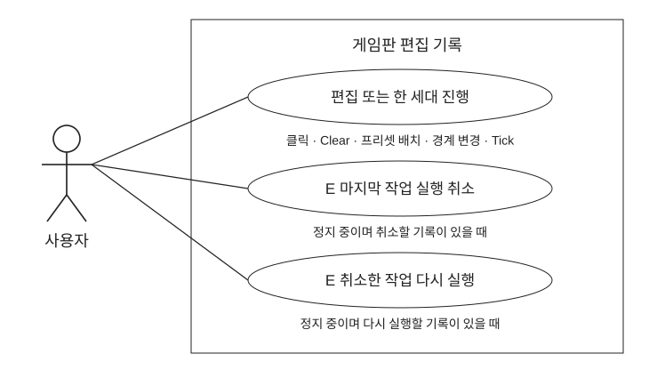
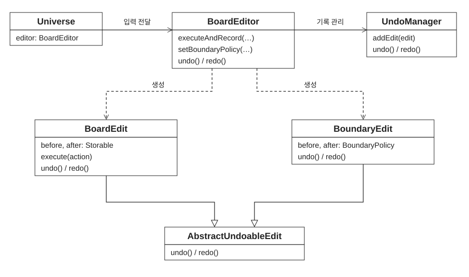
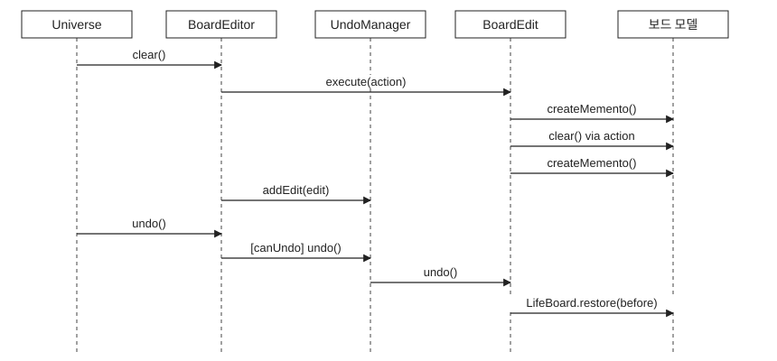
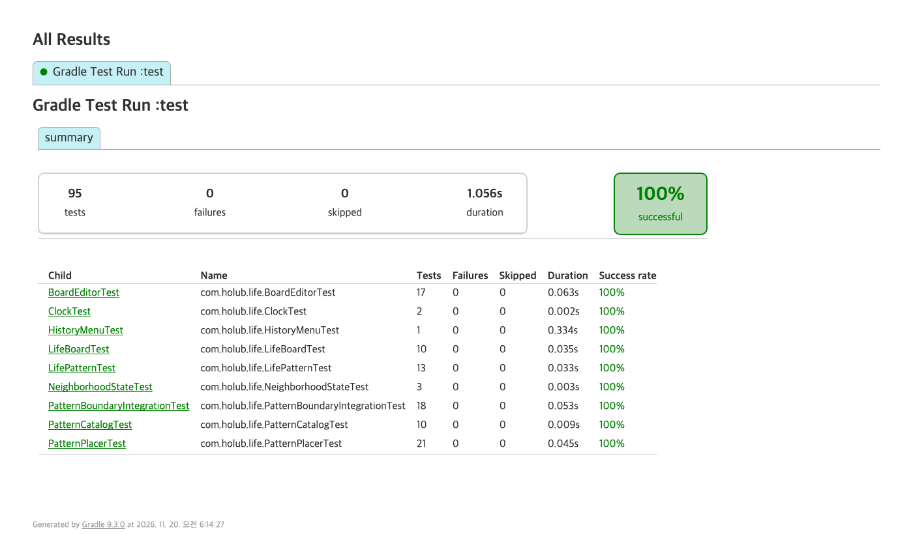

# 게임판 편집과 세대 진행의 실행 취소 및 다시 실행

## 1. 추가한 기능과 사용 방법

### 1.1. 한 세대 되돌려 보기

1. 게임판 중앙에서 가로로 이웃한 세 칸을 차례로 클릭한다.
2. `Go > Tick (Single Step)`을 누른다. 가로 세 칸이 세로 세 칸으로 바뀐다.
3. `Grid > Undo`를 한 번 누르면 Tick 직전의 가로 세 칸으로 돌아간다. 한 번 더 누르면 세 번째 클릭까지 취소되어 가로 두 칸이 남는다.
4. `Grid > Redo`를 두 번 누르면 세 번째 클릭과 Tick이 차례로 복원되어 다시 세로 세 칸이 된다.

자동 진행은 `Go > Halt`로 멈춘 뒤 되돌릴 수 있다. Halt 자체는 기록되지 않는다. 마지막 작업이 Tick이면 첫 Undo에서 한 세대 전으로 돌아간다.

### 1.2. 작업별 기록 단위

| 게임판에서 한 작업 | 기록 방식 |
| --- | --- |
| 셀 클릭 또는 Clear | 클릭한 셀 하나의 상태 전환, 또는 살아 있는 셀 전체를 지운 작업 한 번 |
| 프리셋 배치 | 성공한 배치 전체가 한 단계. 모든 셀이 기존 배치와 겹쳐도 한 건으로 기록 |
| 수동 Tick 또는 자동 진행 | 시계가 진행한 한 세대. 셀 모양이 그대로인 세대도 포함 |
| 경계 모드 변경 | 고정 경계와 연결 경계 사이의 전환 한 번 |
| 빈 게임판에서 Clear, 범위를 벗어난 프리셋 배치, 같은 경계 재선택 | 기록을 추가하지 않고 기존 Undo와 Redo를 유지 |
| 파일 저장 또는 불러오기 | 저장하면 편집 기록을 유지한다. 불러오기에 성공하면 그 게임판에서 새 기록을 시작한다. |

Undo 후 다른 셀을 켜면 방금 취소한 작업은 Redo할 수 없다.

### 1.3. 유스케이스 다이어그램

[유스케이스 다이어그램 원본 SVG](diagrams/usecase_diagram.svg)

## 2. 기능을 추가한 이유

게임판을 지우거나 관찰하려던 세대를 지나쳤을 때, 편집 기록이 없으면 저장 파일을 열거나 초기 배치를 다시 만들어야 한다. Undo가 있으면 이전 세대에서 셀 하나를 바꿔 다른 결과를 관찰할 수 있다. 셀을 바꾸지 않고 Redo를 누르면 앞서 본 결과로 돌아간다.

셀 배치가 같아도 경계나 세대는 달라질 수 있다. 프리셋은 여러 셀이 바뀌어도 클릭 한 번으로 놓는다. 다음 조건은 사용자가 실행한 작업을 기준으로 한다.

- 배치와 당시의 규칙을 함께 복원하도록 경계 변경도 기록한다.
- 프리셋은 한 번에 취소하고, 배치 전부터 살아 있던 셀은 보존한다.
- 복원한 게임판이 다음 Tick으로 바뀌지 않도록 자동 진행 중에는 Undo와 Redo를 잠근다.
- 모양이 같은 두 세대도 각각 기록해 Halt 후 한 세대씩 되짚을 수 있게 한다.
- 새 편집은 이전 Redo를 지운다. 배치 실패나 빈 게임판에서의 Clear는 기록을 유지한다.
- 다른 게임판의 작업이 섞이지 않도록 파일을 성공적으로 열었을 때만 기록을 비운다.
- 셀 클릭은 `Neighborhood.userClicked()`에 맡겨 다음 세대에 다시 계산할 구역도 함께 표시되도록 한다.

## 3. 설계 후보와 선택 과정

### 3.1. 검토한 후보

| 후보 | 기록 방식 | 장점 | 부담 |
| --- | --- | --- | --- |
| Command로 변경분 기록 | 클릭한 좌표, Tick에서 태어나거나 죽은 셀 등 작업별 변경분을 보관한다. | 바뀐 셀이 적으면 기록도 작다. | Tick에서는 변경 좌표를 따로 구해야 한다. |
| Memento로 게임 상태 기록 | 셀 배치와 경계 모드를 함께 저장한다. | 모든 작업을 같은 방법으로 복원할 수 있다. | 경계만 바뀌어도 그 시점의 셀 배치를 보관하거나 직전 배치와 공유해야 한다. |
| Prototype으로 게임판 복제 | 단계마다 게임판의 독립된 복제본을 남긴다. | 당시 게임판을 그대로 보관할 수 있다. | 중첩된 `Neighborhood`와 하위 셀의 복제까지 구현해야 한다. |
| Command + Memento | 셀 편집 명령에는 전후 배치를, 경계 변경 명령에는 전후 모드를 담는다. | 기존 Memento를 재사용해 셀 배치용 저장 구조를 따로 만들 필요가 없다. | 셀 하나를 클릭해도 전후 배치를 보관하는 비용이 든다. |

### 3.2. Command + Memento를 선택한 이유

`LifeBoard.step()`은 배치가 바뀌었는지만 반환한다. 변경 좌표를 따로 구하거나 게임판 전체를 복제하는 대신, 셀 편집 전후에 `Neighborhood.createMemento()`로 생존 좌표를 보관한다. 이 좌표만으로 Clear와 Tick 전후의 배치를 복원할 수 있다.

셀 배치와 경계 모드를 하나의 Memento로 관리할 수도 있다. 다만 경계를 바꾼 직후 Undo할 때 필요한 값은 이전 모드 하나다. 그래서 셀 편집은 기존 Memento로 복원하고, 경계 변경은 전후 모드만 담는 명령으로 기록했다. 두 명령은 같은 편집 기록에 실행 순서대로 추가한다.

## 4. 클래스 구조와 책임

[클래스 다이어그램 원본 SVG](diagrams/class_diagram.svg)

| 구분 | 클래스 | Undo/Redo에서 맡는 일 |
| --- | --- | --- |
| 신규 | `BoardEditor` | 편집을 실행하고 기록할 명령을 `UndoManager`에 등록한다. |
| 신규 | `BoardEdit`, `BoundaryEdit` | `BoardEditor`의 내부 클래스다. 각각 셀 배치와 경계 모드를 복원한다. |
| 기존 클래스 수정 | `Universe` | 메뉴·마우스·시계 입력을 `BoardEditor`에 전달하고 Undo·Redo 메뉴 상태를 갱신한다. |
| 기존 클래스 수정 | `LifeBoard` | `restore()`로 파일 불러오기와 편집 기록 복원에 같은 절차를 사용한다. `boundaryPolicy()`로 현재 경계를 조회한다. |
| 기존 클래스 수정 | `Clock` | `Clock.Listener.playbackChanged()`로 재생 상태 변경을 알리고, `isRunning()`으로 실행 여부를 제공한다. |
| 기존 클래스 수정 | `Neighborhood` | `hasLivingCells()`로 살아 있는 셀이 있는지 확인한다. 이미 빈 게임판에서 Clear를 누르면 기록을 추가하지 않는다. |
| 기존 타입 재사용 | `NeighborhoodState`, `BoundaryPolicy`, `PatternPlacer` | 셀 배치 보관, 경계 모드 표현, 프리셋 배치에는 기존 타입을 그대로 사용한다. |
| Swing 라이브러리 | `UndoManager`, `AbstractUndoableEdit` | `UndoManager`는 편집 기록을 관리하고, 두 명령은 `AbstractUndoableEdit`를 상속해 Undo와 Redo를 구현한다. |

### Command 패턴의 역할

| 역할 | 담당 클래스 | 이 구현에서 하는 일 |
| --- | --- | --- |
| Command | Swing의 `UndoableEdit` | `UndoManager`가 두 명령에 공통으로 호출하는 `undo()`와 `redo()`를 정의한다. |
| Client | `BoardEditor` | 셀 편집은 `BoardEdit.execute(action)`으로 먼저 실행한다. 경계는 새 모드를 적용한 뒤 `BoundaryEdit`를 만든다. 기록 대상인 명령을 `UndoManager`에 등록한다. |
| Concrete Command | `BoardEdit` | Undo는 편집 전 Memento를, Redo는 편집 후 Memento를 `LifeBoard.restore()`에 전달한다. |
| Concrete Command | `BoundaryEdit` | Undo는 이전 경계 모드를, Redo는 새 경계 모드를 `LifeBoard.setBoundaryPolicy()`에 전달한다. |
| Invoker | Swing의 `UndoManager` | 취소하거나 다시 실행할 명령을 기록에서 골라 그 명령의 `undo()` 또는 `redo()`를 호출한다. |
| Receiver | `LifeBoard`, `Neighborhood` | `LifeBoard`는 경계 설정과 배치 복원을 맡고, `Neighborhood`는 셀을 지우거나 보관한 좌표를 반영한다. |

### Memento 패턴의 역할

| 역할 | 담당 클래스 | 이 구현에서 하는 일 |
| --- | --- | --- |
| Originator | `Neighborhood` | `createMemento()`로 현재 생존 셀의 좌표를 담고, 복원 시 전달받은 좌표를 게임판에 반영한다. |
| Memento | `Neighborhood.NeighborhoodState` | `Cell.Memento`를 구현하며 한 시점의 생존 셀 좌표를 보관한다. |
| Caretaker | `BoardEdit` | 전후 Memento를 보관했다가 Undo·Redo 때 복원할 쪽을 전달한다. |

## 5. 기존 게임과의 비교 및 연동

### 5.1. 최초 게임에 추가한 기능

최초 게임(`4fbc125`)에서 `Universe`는 클릭과 Clear를 게임판에 바로 반영하고, Tick을 받으면 다음 세대를 계산했다. Memento는 파일로 게임판을 저장하고 불러올 때 사용했다. Undo/Redo는 같은 Memento를 편집 기록에도 사용해 클릭·Clear·Tick을 `Grid > Undo`와 `Grid > Redo`로 되짚을 수 있게 했다.

### 5.2. 팀 버전에 맞춰 추가한 부분

Undo/Redo 적용 직전의 `main`(`170b49f`)에는 경계 모드와 프리셋이 있었고, 세대 계산과 파일 처리는 `LifeBoard`가 맡고 있었다.

| 팀 버전의 동작 | Undo/Redo와 연결한 부분 |
| --- | --- |
| `PatternPlacer.place()`가 프리셋 배치의 성공 여부를 반환한다. | 배치가 성공하면 전체를 한 건으로 등록하고, 실패하면 기존 Redo를 유지한다. |
| `LifeBoard.setBoundaryPolicy()`가 다음 세대에 사용할 경계를 바꾼다. | 실제로 모드를 바꿨을 때 이전 값과 새 값을 기록한다. |
| `LifeBoard.step()`이 한 세대를 진행하고 배치의 변화 여부를 반환한다. | 한 세대를 기록한다. 셀 배치가 그대로면 그 단계의 전후 상태에 같은 Memento를 사용한다. |
| `LifeBoard.load()`가 게임판을 비우고 파일에서 읽은 좌표를 복원한다. | 복원 부분을 `restore()`로 분리해 파일 불러오기와 편집 기록 복원에 함께 쓴다. |

### 5.3. 경계를 바꾼 직후의 Undo

고정 경계에서 맨 윗줄 가로 세 칸을 Tick하면 위쪽에 세로 두 칸이 남는다. 여기서 연결 경계로 바꿨다고 하자. 셀 배치만 기록하는 방식이라면 Undo 후에는 연결 경계에 가로 세 칸이 놓인다. 그런데 연결 경계에서는 그 가로 세 칸의 다음 세대에 맨 아래에도 한 칸이 생긴다. 복원한 배치를 방금 본 두 칸의 직전 세대로 설명할 수 없고, 새 경계로 과거를 다시 계산해도 당시 없던 셀이 나타난다.

경계 변경도 한 단계로 기록하므로, 첫 Undo는 세로 두 칸을 유지한 채 경계와 메뉴 표시를 고정으로 되돌린다. 두 번째 Undo가 Tick을 취소해 가로 세 칸을 복원한다.

### 5.4. 자동 진행과 기록 한도

`Universe`는 `Clock`의 재생 상태 변경 알림을 받아 네 가지 속도 모두에서 Undo와 Redo를 비활성화한다. Halt 후에는 `canUndo()`와 `canRedo()`를 각각 확인해 가능한 메뉴만 켠다.

`LifeBoard.step()`이 변화가 없었다고 알려 주면 해당 `BoardEdit`의 전후 상태가 같은 Memento 하나를 가리킨다. 세대별 기록은 유지하면서 같은 좌표를 다시 수집하는 비용을 줄였다. 기록 한도는 `UndoManager`의 기본값인 최근 100건이다. 따라서 정물에서 자동으로 100세대를 진행하면 그보다 앞선 클릭은 기록에서 밀려난다.

### 5.5. 파일 불러오기와 편집 중 복원

`LifeBoard.restore()`는 기존 셀을 지우고 보관한 좌표를 복원한다. 복원된 셀도 이웃 계산에 반영되도록 다음 Tick에서는 모든 블록을 다시 계산한다.

기록을 비우는 처리는 `BoardEditor.load()`에 두었다. 파일을 열 때와 Undo할 때 모두 호출하는 `restore()`에서 기록을 비우면, 첫 Undo에서 남은 기록까지 사라진다.

### 5.6. Clear 직후 Undo의 호출 순서

살아 있는 셀이 있을 때 Clear를 실행하면 `BoardEdit`가 실행 전후 배치를 얻고 `BoardEditor`가 명령을 등록한다. 이어서 Undo를 선택하면 같은 명령이 `LifeBoard.restore(before)`에 직전 배치를 전달한다.

그림의 ‘보드 모델’에는 `Neighborhood`와 `LifeBoard`의 호출을 함께 표시했다.

[시퀀스 다이어그램 원본 SVG](diagrams/sequence_diagram.svg)

## 6. 검증

### 6.1. 검증 대상과 주요 사례

Java 21 · Gradle 9.3.0 · JUnit Jupiter 5.11.4. 전체 95건이 통과했고 실패와 건너뜀은 0건이었다. 게임판과 편집 기록은 화면 없이 [BoardEditorTest](../../src/test/java/com/holub/life/BoardEditorTest.java) 17건으로 검증했다. Swing 메뉴 상태는 [HistoryMenuTest](../../src/test/java/com/holub/life/HistoryMenuTest.java) 1건으로 확인했다.

| 사례 | 확인한 내용 |
| --- | --- |
| 클릭 한 번 | Undo로 빈 게임판을 복원한 뒤 Redo로 같은 좌표를 다시 켠다. |
| 여러 단계 복원 | 두 셀을 켜고 Clear한 뒤 Undo·Redo를 두 번씩 실행해 각 단계의 모양을 비교한다. |
| 다른 편집 시작 | Undo 뒤 다른 셀을 켜면 Redo를 눌러도 새 게임판이 유지된다. |
| 빈 기록 | 첫 편집 전 Undo와 Redo를 눌러도 예외 없이 빈 게임판을 유지한다. |
| 세대 진행 후 Undo | 블록 경계에서 다음 세대로 진행한 뒤 Undo 두 번으로 직전 세대와 마지막 클릭 전의 모양을 복원한다. |
| 수동 Tick과 연속 복원 | 가로 세 칸을 두 세대 진행하고 Undo 세 번으로 앞선 두 세대와 마지막 클릭을 되짚는다. Redo 세 번으로 매 단계를 다시 확인한다. |
| 수동 Tick과 새 경로 | Clear를 취소하고 수동 Tick을 누르면 이전 Clear는 Redo로 다시 실행할 수 없다. |
| 모양이 같은 두 세대 | 2×2 정사각형에서 Tick과 Undo를 눌러 같은 모양을 확인한다. Undo를 한 번 더 눌러야 마지막 셀이 꺼진다. |
| 메뉴 활성화 | 네 가지 재생 속도에서 Undo·Redo가 모두 비활성화되고, Halt 또는 수동 Tick 직후에는 가능한 작업만 활성화되는지 확인한다. |
| 기록 한도 | 101세대를 진행한 뒤 Undo를 반복해 최근 100단계를 복원하고, 한도에 도달한 뒤에는 같은 상태를 유지한다. |
| 파일 왕복 | 저장 후에는 Undo가 가능하고, 저장한 파일을 불러오면 새 게임판에서 이전 기록이 무효가 된다. |
| 기존 파일 호환 | 기존 저장 코드처럼 같은 좌표가 두 번 들어 있는 직렬화 목록을 불러와 해당 셀 하나만 켜지는지 확인한다. |
| 읽기 실패 | 빈 파일을 불러와 읽기 오류가 발생해도 기존 셀과 Undo 기록이 유지되는지 확인한다. |
| 프리셋 배치 | 겹치는 셀을 포함한 배치를 한 번에 복원하고 실패한 배치 뒤에도 Redo가 유지된다. |
| 경계 모드와 복원 | 복원한 Blinker가 연결 경계와 고정 경계에서 각각 예상한 모양이 된다. |
| 경계와 세대 순서 | 경계 변경과 실제 세대를 입력 순서대로 Undo·Redo한다. |
| 같은 경계 재선택 | 같은 모드는 Redo를 보존하고 다른 모드는 새 이력을 시작한다. |
| 빈 게임판에서 Clear | 이미 빈 게임판을 지워도 기록을 추가하지 않으며 기존 Undo와 Redo를 유지한다. |

JUnit과 별도로 Swing의 Slow 메뉴로 글라이더를 네 세대 진행하고 Halt로 멈췄다. Undo 네 번과 Redo 세 번을 차례로 실행해 매번 예상 좌표와 비교했고, 마지막 Redo 후 0.5초 동안 추가 Tick이 발생하지 않는지 확인했다.

### 6.2. 실행 방법과 결과

프로젝트 루트에서 `./gradlew test --rerun-tasks`를 실행한다. 화면을 사용할 수 없는 환경에서는 Swing 메뉴 테스트를 건너뛴다. 결과 보고서는 `build/reports/tests/test/index.html`에 생성된다.

